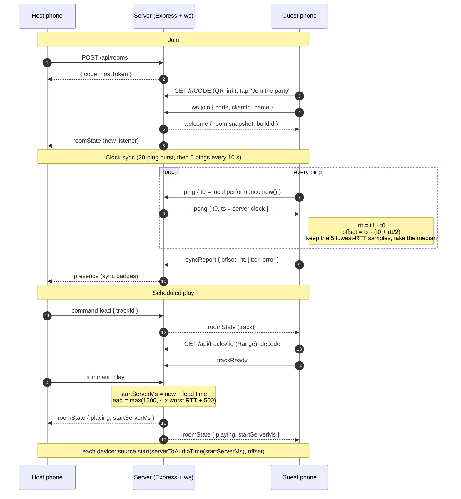

# Silent Disco Sync

Silent Disco Sync turns a group of phones into one synchronized sound system. A host opens a
room, everyone else scans a QR code, and at a scheduled instant every phone starts the same
audio within a few milliseconds of the others. Line six phones up and it sounds like one big
speaker, not an echo. Under the hood it is an NTP-style clock synchronization protocol over
WebSockets, scheduled Web Audio playback on that shared clock, and a drift controller that
keeps every device on the same timeline for the whole song. It can also live-share a browser
tab, so the host can play YouTube to the room.

**Live:** https://silent-disco-sync.onrender.com (free tier: the first visit after ~15 min idle
takes 30-60 s to wake up)

> **Demo GIF:** _placeholder. Record six phones on the click-track sync test with the beat flash
> on, save it as `docs/demo.gif` and embed it here._

## Contents

- [How it works](#how-it-works)
- [How clock sync works](#how-clock-sync-works)
- [Scheduled playback and drift control](#scheduled-playback-and-drift-control)
- [Live share (YouTube and other tabs)](#live-share-youtube-and-other-tabs)
- [Measured accuracy](#measured-accuracy)
- [Known limitations](#known-limitations)
- [Local setup](#local-setup) · [Environment variables](#environment-variables) ·
  [Deployment](#deployment) · [Tests](#tests) · [Project layout](#project-layout)
- [Future work](#future-work)

## How it works

1. The host taps **Start a room** and gets a 4-character code and a QR code.
2. Guests scan the QR (or type the code), enter a name and tap **Join the party**. That tap is
   required: browsers (iOS Safari especially) only allow audio after a user gesture.
3. Each phone synchronizes its clock with the server and reports its sync quality.
4. The host picks a track (or uploads one). Every phone downloads and decodes it, then reports
   ready.
5. The host taps **Play**. The server stamps a start time about 2 s in the future, in server
   time, and broadcasts it. Every phone converts that instant to its own audio clock and
   schedules the first sample for exactly then.
6. Pause, resume and seek work the same way: every command is a future server timestamp, never
   "do it now". Late joiners compute the live position and start mid-song in sync.



The server is authoritative for room state. Only the host connection can send commands, and
every message is validated with zod schemas shared by both sides (`shared/src/protocol.ts`).

## How clock sync works

The module is `client/src/sync/clockSync.ts`. It is framework-free and DOM-free: time, timers
and transport are injected, so the same code runs in the browser, in the simulator and under
deterministic virtual time in the unit tests.

**One sample = one round trip.** The client sends `ping { t0 }` with its own
`performance.now()`. The server immediately answers `pong { t0, ts }`, where `ts` is the server
clock. The client stamps `t1` on arrival, before parsing anything, then computes:

```
rtt    = t1 - t0
offset = ts - (t0 + rtt / 2)        // server time minus local time
```

The server clock is `performance.timeOrigin + performance.now()`: epoch milliseconds with
sub-millisecond resolution, and monotonic, so it never jumps when the OS steps its wall clock.
Clients never need it to match real UTC, only to be one consistent clock.

**Why trust the lowest-RTT samples (the NTP clock-filter idea).** The formula assumes the ping
took as long to go as the pong took to come back. What breaks that assumption is _queueing_:
a packet waiting in a router, a Wi-Fi retry, a busy uplink. Queueing only ever _adds_ delay, and
it is rarely equal in both directions. So the samples with the smallest round trip are the ones
that waited in the fewest queues, and their midpoint is the closest to the truth. Each estimate
is the **median offset of the 5 best samples** in a 30 s window. On a burst of 20 pings, 15 are
thrown away.

- **Burst on join:** 20 pings, 100 ms apart. **Background re-sync:** 5 pings every 10 s.
- **Ranking:** "best" means lowest `rtt/2` plus a small age penalty (0.25 ms per second of age,
  like NTP's growing dispersion), so the estimate follows real clock changes while still
  preferring clean samples.
- **Slew limit:** a new estimate never jumps the clock during playback. The applied offset moves
  toward it at no more than **2 ms per second**. When nothing is playing it steps immediately.
- **Two deliberate exceptions:** (1) every sample pins the true offset inside
  `offset ± rtt/2`; if a new burst's interval doesn't overlap the window's, the clock really
  stepped (some phones pause `performance.now()` while asleep), so the old window is dropped.
  (2) A gap over 50 ms is stepped even during playback, because slewing it would mean ~25 s of
  audible echo, while a step costs one re-schedule.
- **Exposed:** `serverNow()`, `offsetMs`, `rttMs`, `jitterMs` (standard deviation of the kept
  samples), `boundMs` (worst-case error, half the best RTT) and `errorMs` (the estimate used for
  the badges: jitter of the kept samples, combined with how much consecutive estimates disagree,
  plus any slew still in progress).

The badges show `errorMs`: green under 10 ms, amber under 30 ms, red above. The worst-case
bound is shown separately in the Sync Lab. Over the internet (~120 ms round trip) the bound is
~60 ms for everyone, which would make every badge red even when sync is excellent. The bound
only becomes the real error if all the delay sits on one side of the trip.

**From server time to the speaker.** `serverToAudioTime()` converts a server timestamp to the
`AudioContext` time at which a source must start so that its first sample _leaves the speaker_
at that instant. It uses `ctx.getOutputTimestamp()`, which pairs a context time with the
`performance.now()` moment that sample is output, so the reported output latency is already
inside the pair. Where that's unavailable it falls back to `currentTime` minus
`ctx.outputLatency`. A per-device **nudge** (−250 to +250 ms, saved per device) is added on top
for latency the browser cannot report, such as Bluetooth.

## Scheduled playback and drift control

Room playback state is `{ trackId, status, startServerMs, positionAtStartSec, seq }`. While
playing, the position at server time `T` is `positionAtStartSec + (T - startServerMs) / 1000`
(`shared/src/playback.ts`, pure and unit-tested).

- **Scheduling:** `source.start(serverToAudioTime(startServerMs), positionAtStartSec)`. If that
  moment already passed (late join, slow decode, reconnect), the player computes the current
  position and starts ~150 ms ahead at the matching offset.
- **Seek while playing** schedules the new source and stops the old one at the same audio-clock
  instant, so the handover is gapless.
- **Lead time** is automatic: `max(1500, 4 × worst RTT + 500)` ms, capped at 4000 ms. It is
  computed from the median RTT that clients report.
- **Late joiners** wait for their first sync burst before scheduling anything. Scheduling with an
  unsynced clock (offset 0) would put the start decades away.

**Drift control** (`client/src/audio/drift.ts`). Every 2 s the player compares where its audio
_actually_ is (the sample leaving the speaker now, via `getOutputTimestamp`) with where the room
says the track should be at that same heard instant:

| Drift       | Action                                               |
| ----------- | ---------------------------------------------------- |
| under 15 ms | nothing (once correcting, continue until under 3 ms) |
| 15 to 80 ms | nudge `playbackRate` by up to ±0.3% until corrected  |
| over 80 ms  | hard re-schedule at the next boundary                |

**Why the rate nudge is inaudible:** a 0.3% speed change shifts pitch by about 5 cents. The
smallest pitch change most listeners notice on music is roughly 10-25 cents, and the change is
gradual. Yet it removes 6 ms of drift every 2 s. Every correction is logged to a ring buffer and
shown in the Sync Lab next to a live drift chart.

Other resilience: a **Screen Wake Lock** while anything plays (re-acquired when the page
returns), a **"tap to enable sound"** overlay when the `AudioContext` is suspended, iOS
`navigator.audioSession.type = 'playback'` so the silent switch doesn't mute Web Audio,
**reconnects** (immediately on `online`, and when a visible tab hears nothing for 25 s), and a
rejoin that re-runs the full sync burst and catches up without restarting audio that is still
correct.

### Bundled tracks

Three original tracks are synthesized by `server/scripts/generate-tracks.ts` (CC0), plus a
120 BPM click track synthesized on each device. The bundled tracks are **WAV on purpose**: MP3
and AAC encoders prepend ~25-50 ms of priming samples that browsers trim inconsistently, which
would desync a Chrome phone from a Safari phone before any sync code ran. WAV starts on sample 0
everywhere. Uploads accept mp3, m4a and wav (max 12 MB), are checked by their actual bytes, live
in the OS temp dir and are deleted when the room expires.

## Live share (YouTube and other tabs)

The host can play anything from another browser tab: YouTube, Spotify Web, SoundCloud.

1. **Capture:** **Share tab audio** calls `getDisplayMedia`. The host picks the tab with "Also
   share tab audio" on, and the tab is muted locally (`suppressLocalAudioPlayback`).
2. **Chunking:** an `AudioWorklet` cuts the audio into 100 ms mono chunks at 24 kHz (16-bit PCM,
   about 384 kbit/s).
3. **Timeline:** each chunk carries an index on a sample-count timeline anchored at a server
   time.
4. **Relay:** the server relays binary frames from the host only. It drops frames for stale
   streams, and drops rather than queues frames for listeners more than 1 MB behind.
5. **Playback:** every device, the host included, plays chunk `n` at
   `anchor + n × 100 ms + delay`, so they all sound together about 2 s behind the tab. Chunks
   are scheduled back to back from a cursor, which is steered toward that ideal time with the
   same drift policy as tracks (rate nudge for 15-80 ms, jump beyond).
6. **Seamless joins:** the receiver upsamples each chunk itself, continuing from the previous
   chunk's last sample, so chunk boundaries don't click.
7. **No uplink bias:** the host holds its uploads while its clock runs a ping burst, so the pings
   don't queue behind its own audio.
8. **Re-anchors without silence:** when the host reconnects, the new stream continues the old
   sample timeline, so listeners hear no gap. Only a real capture-clock drift (judged on the
   earliest arrivals over 5 s, so a stalled tab can't trigger it) starts a fresh timeline.

The host must use desktop Chrome, Edge or Brave (Safari, Firefox and phones can't capture tab
audio). Guests can use anything. Rebroadcast only what you have the right to play to the room.

## Measured accuracy

### Simulator (`npm run sim -- --all`)

`sim/src/index.ts` boots the real server and runs 20 virtual clients per scenario. Each client
runs the real `ClockSync` module with its own clock (offset by up to an hour, drifting by up to
±100 ppm) and its own link. The link adds base latency, fixed one-way asymmetry, exponential
queueing split between uplink and downlink, and rare retransmit spikes, all delivered in TCP
order. Server and clients share one process, so every client's **true** offset is known exactly.
"Start error" is how far from the scheduled server instant each client actually starts a play.
"Naive" averages every sample of the last burst instead of filtering. Raw data:
`sim/results/*.csv`.

Simulated with 20 clients per scenario, 60 s each, seed 42.

| Scenario    | One-way latency | Asymmetry | Queueing (mean, % uplink) | Offset error median | p90      | p99      | Naive mean, median | Start error median | Start error max | Late arrivals | Within rtt/2 bound |
| ----------- | --------------- | --------- | ------------------------- | ------------------- | -------- | -------- | ------------------ | ------------------ | --------------- | ------------- | ------------------ |
| **lan**     | 1-4 ms          | ±0.5 ms   | 0.2-2 ms, 50%             | 0.27 ms             | 0.70 ms  | 1.15 ms  | 0.24 ms            | 0.27 ms            | 1.28 ms         | 0/100         | 100%               |
| **wifi**    | 10-40 ms        | ±4 ms     | 1-10 ms, 60%              | 1.32 ms             | 2.60 ms  | 4.28 ms  | 1.79 ms            | 1.39 ms            | 4.73 ms         | 0/100         | 100%               |
| **mobile**  | 30-90 ms        | ±10 ms    | 5-30 ms, 75%              | 2.80 ms             | 6.38 ms  | 8.62 ms  | 8.83 ms            | 2.77 ms            | 8.79 ms         | 0/100         | 100%               |
| **hostile** | 50-150 ms       | ±30 ms    | 20-60 ms, 85%             | 7.82 ms             | 20.05 ms | 26.95 ms | 28.25 ms           | 8.00 ms            | 27.36 ms        | 0/100         | 100%               |

What this shows:

- **The filter matters where queueing is one-sided:** on mobile and hostile networks the
  lowest-RTT median is 3-3.6× more accurate than averaging. On a clean LAN they're equal.
- **What's left is asymmetry:** in the hostile scenario a fixed one-way difference of up to
  ±30 ms limits any round-trip method to ±15 ms. That's what the rtt/2 bound expresses, and 100%
  of samples stayed inside it.
- **Lead time adapts:** it grew from 1.5 s to ~3 s on the hostile network, and no client ever
  received a play command too late to schedule it.

### Real network and real browsers

| Measurement                                                                                                   | Result                                                                   |
| ------------------------------------------------------------------------------------------------------------- | ------------------------------------------------------------------------ |
| 24 `ClockSync` clients on one Mac vs the Render server (Singapore, ~120 ms RTT), 120 s (`sim/src/realnet.ts`) | error vs consensus median **1.85 ms**, p90 4.76 ms                       |
| Rendered audio, two headless Chrome "phones", click track (sample-accurate onset detection)                   | **0.08 ms** median apart                                                 |
| Same, a phone joining mid-song                                                                                | **0.20 ms**                                                              |
| Same, music cross-correlated after a seek                                                                     | **0.15 ms**                                                              |
| WebKit (Safari engine) host vs Chrome guest on the live Render site                                           | **2.3 ms** median, 2.75 ms max                                           |
| Live share, host vs guest on the live Render site, 5 runs                                                     | 1.1, 1.7, 5.3, 7.2 and 14.1 ms (set by each connection's path asymmetry) |
| Drift control, +40 ms injected clock error                                                                    | corrected at the 0.3% cap (1.5 ms per 0.5 s), no jumps                   |

For reference, two sounds closer than roughly 10-20 ms are heard as one, which is the threshold
this project is built around.

## Known limitations

- **Bluetooth and unreported output latency.** Bluetooth speakers and earbuds add 100-300 ms
  that browsers usually don't report, and it differs per device. The per-device nudge with the
  tap-along calibration in the Sync Lab corrects it, but someone has to run it once per device.
- **Path asymmetry.** Each connection's one-way imbalance is invisible to any round-trip method.
  Over the internet that leaves a few milliseconds of disagreement between devices (see above).
  A server in the same city, or on the same Wi-Fi, is more accurate.
- **Background tabs on iOS.** iOS suspends audio in background tabs and when the screen locks
  without a wake lock. The wake lock keeps the screen on while playing. If iOS still suspends the
  context (an incoming call, for example), the "tap to enable sound" overlay brings it back and
  the device rejoins at the live position.
- **Free-tier cold starts.** Render's free instance sleeps after 15 idle minutes, and the first
  request takes 30-60 s. The UI says so. Rooms live in memory, so a restart or redeploy ends
  every room.
- **Live share** needs a desktop Chromium host, runs about 2 s behind the source tab, and is mono
  at 24 kHz.
- Lead time trades responsiveness for safety: commands take effect 1.5-4 s after the tap.

## Local setup

Requires Node 20.19+ (see `.nvmrc`).

```bash
npm install
npm run dev        # server on :3000, Vite on :5173 (also on your LAN IP)
```

Open the **Network** URL Vite prints (e.g. `http://192.168.1.20:5173`) on your laptop, so the
QR code points at an address phones can reach. Wake lock, the service worker and PWA install
need HTTPS, so test those on the deployed site.

Production build, as Render runs it:

```bash
npm run build && npm start   # http://localhost:3000
```

| Command                                                 | What it does                                                    |
| ------------------------------------------------------- | --------------------------------------------------------------- |
| `npm run dev`                                           | Server (tsx watch) and Vite dev server together                 |
| `npm run build`                                         | Build the client, then bundle the server                        |
| `npm start`                                             | Production server: client, REST API and WebSocket on one origin |
| `npm test`                                              | Vitest: unit and integration tests                              |
| `npm run sim -- --all`                                  | Simulator, all scenarios, writes `sim/results/`                 |
| `npm run realnet -w sim -- <url> <seconds> <clients>`   | Real-network sync experiment against a server                   |
| `npm run tracks:generate -w server`                     | Re-synthesize the bundled tracks                                |
| `npm run lint` / `npm run typecheck` / `npm run format` | ESLint, strict TypeScript, Prettier                             |

## Environment variables

Copy `server/.env.example` or `client/.env.example` for local overrides. Real `.env` files are
git-ignored. There are no secrets: the app needs no API keys or database.

| Variable             | Where          | Default                     | Purpose                                                                        |
| -------------------- | -------------- | --------------------------- | ------------------------------------------------------------------------------ |
| `PORT`               | server         | `3000`                      | HTTP and WebSocket port                                                        |
| `NODE_ENV`           | server         | `development`               | `production` enables trust-proxy defaults                                      |
| `ALLOWED_ORIGINS`    | server         | empty                       | Extra origins allowed on the WebSocket upgrade (same origin is always allowed) |
| `LEAD_MS_DEFAULT`    | server         | `2000`                      | Lead time before any client has reported its RTT (1500-4000)                   |
| `TRUST_PROXY`        | server         | `1` in production, else `0` | Reverse-proxy hops to trust for client IPs (rate limiting)                     |
| `CLIENT_DIST`        | server         | `client/dist`               | Built client to serve                                                          |
| `ASSETS_DIR`         | server         | `server/assets`             | `tracks.json` and bundled audio                                                |
| `UPLOAD_DIR`         | server         | `<os tmp>/sds-uploads`      | Upload storage, wiped on boot                                                  |
| `VITE_PUBLIC_ORIGIN` | client (build) | page origin                 | Origin encoded in the QR join link                                             |

## Deployment

One Render web service serves the built client, the REST API and the WebSocket on the same
origin, so there is no CORS and `wss://` just works. The Blueprint is `render.yaml`.

1. Push the repo to GitHub.
2. In Render: **New → Blueprint**, then connect the repo. It creates one free web service in
   Singapore with `npm ci --include=dev && npm run build` as the build and `npm start` as the
   start command, health check at `/api/health`.
3. To check a deploy is live, compare `/build-id.txt` with the commit
   (`curl https://<service>.onrender.com/build-id.txt`). Tabs left open across a deploy show a
   "new version, reload" banner.

## Tests

```bash
npm test
```

69 tests, run with Vitest:

- **clockSync** (deterministic fake network with seeded jitter and virtual time):
  - stable network, high jitter, uplink queueing, fixed asymmetry
  - a mid-session latency spike
  - slew rate limit and monotonic `serverNow`
  - stepping when idle, step detection
  - 50 ppm drift, 30% packet loss, retries, restart
  - server-to-AudioContext mapping (with and without `getOutputTimestamp`)
- **Playback math:** play, pause, resume, seek (playing and paused), clamping, restart at the
  end, late join. Also lead-time selection.
- **Drift policy, live-share codec, seamless upsampling, chart ticks.**
- **Integration** (real server and WebSocket clients):
  - health, room create and lookup, origin rejection, ping/pong, join and presence
  - track list, Range streaming, uploads (host-only, magic-byte check)
  - host-only commands, readiness gating, live-share relay, host-disconnect cleanup
  - **a scheduled play reaching every client with `startServerMs = server now + lead time`**

## Project layout

```
client/   React + Vite + Tailwind PWA
  src/sync/clockSync.ts     the clock sync module (+ tests, fake network)
  src/audio/                engine, track store, scheduled player, drift control, click track
  src/live/                 tab capture (host) and live receiver
  src/routes/               Landing, Room, Sync Lab
server/   Express 5 + ws: rooms, commands, track streaming, uploads, live relay
  assets/                   bundled WAV tracks + tracks.json
shared/   zod protocol, playback math, live-share codec, limits
sim/      simulator and real-network experiment, results/
```

## Future work

- An `AudioWorklet` player with sample-accurate resampling, for sub-millisecond drift
  correction without touching `playbackRate`.
- Opus (WebCodecs) for live share where guests support it: about 8× less bandwidth than PCM.
- Measure each phone's real output latency with its microphone (play a chirp and listen for it),
  replacing manual calibration.
- Multiple server regions, picking the one with the lowest RTT for the room's members.
- Persist rooms (Redis) so redeploys don't end parties.
